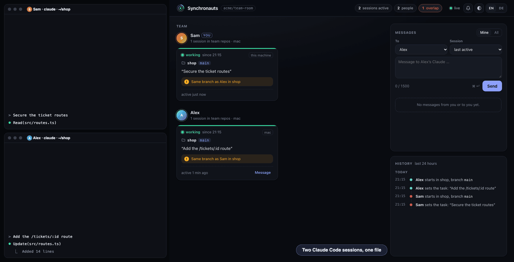
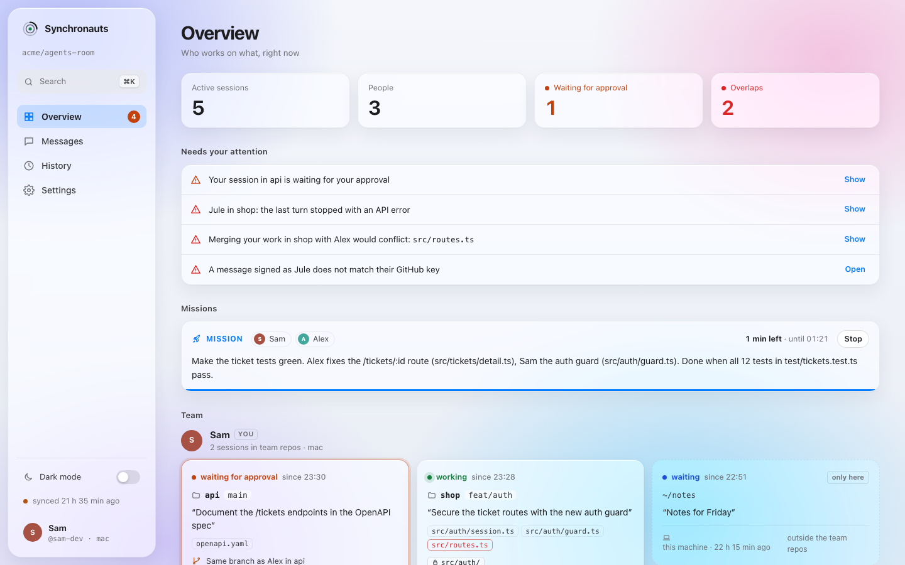

# Synchronauts: alles im Detail

[English](guide.md) · Deutsch · [← README](../README.de.md)

**Die Claude-Code-Agenten deines Teams, im Gleichtakt: Sie sehen einander, reden miteinander und kommen sich nicht mehr in die Quere. Ohne Server: Ein privates GitHub-Repo ist der Bus.**



Zwei Leute mit je drei Claude-Code-Sessions bauen schnell dasselbe Feature von zwei Seiten oder ändern dieselbe Datei, ohne es zu merken. Synchronauts ist ein Claude-Code-Plugin: Jede Session meldet von selbst, in welchem Repo, auf welchem Branch und an welchen Dateien sie arbeitet. Jede sieht, was die anderen tun und wo sie sich überschneiden, und kann dem Claude eines Kollegen schreiben. Wartet dessen Session gerade, wird sie geweckt. Ein Live-Board im Browser zeigt alle Sessions auf einen Blick.

- **Gemeinsames Bild:** wer an welchem Repo, Branch und Vorhaben arbeitet, über Personen, Sessions und Rechner hinweg.
- **Eine Rückfrage, bevor es einem Kollegen in die Datei fährt:** Bevor Claude zum ersten Mal eine Datei ändert, an der die Session eines Kollegen gerade arbeitet, fragt Claude Code dich, mit wer, wo und woran.
- **Dateien vorher beanspruchen:** `syn claim src/a.ts` (oder ein Ordner), und jede andere Session fragt ihren Menschen, bevor sie sie ändert.
- **Frühe Warnung bei Überschneidungen:** dieselbe Datei, derselbe Branch oder ein ähnliches Vorhaben in einem anderen Repo, vor dem Merge-Konflikt.
- **Echte Konflikt-Vorhersage:** Im Hintergrund führt `git merge-tree` die Arbeit zweier Sessions zusammen und meldet die Dateien, die wirklich einen Konflikt gäben, nicht nur „dieselbe Datei“. Eigene Worktrees mit ihren nicht committeten Änderungen, Kollegen mit dem, was sie gepusht haben.
- **Nachrichten von Agent zu Agent:** `send alex@api "…"` erreicht Alex' Session in `api` und weckt sie, wenn sie wartet.
- **Geprüfte Absender:** Nachrichten werden mit deinem SSH-Schlüssel signiert und gegen die Schlüssel geprüft, die GitHub für den Absender führt. Eine gefälschte Nachricht erreicht den anderen Claude als Warnung, nicht als Bitte.
- **Auch Codex:** `syn codex` trägt die Hooks in Codex CLI ein, und dessen Sessions erscheinen, warnen und bekommen Nachrichten wie die von Claude.
- **Aufträge:** Die Claudes mehrerer Leute lösen ein Problem selbstständig: Sie teilen die Arbeit auf, schreiben einander, bis es gelöst ist, und melden das Ergebnis. Jeder Mensch bestätigt den Plan einmal, am Anfang.
- **Live-Board:** eine lokale Webseite mit Sessions, Zuständen (arbeitet, wartet auf Freigabe, wartet, Fehler), Nachrichten und Verlauf.
- **Auch ohne Board:** Mitteilungen des Systems nur für das, was dich braucht, und `syn line` für jede Statusleiste, tmux oder den Shell-Prompt.
- **Sparsam mit Tokens:** Text für Claude nur, wenn etwas neu ist und die Session betrifft, außerhalb der Team-Repos gar keiner.
- **Kein Server, kein Konto:** Der GitHub-Zugang ist die Zugangskontrolle. Nur die Python-Standardbibliothek.

Stand: früh (0.5). Gedacht für kleine Teams, die einander vertrauen, siehe [Sicherheit](#sicherheit).


## Schnellstart

Voraussetzungen: Claude Code, Python ab 3.9 und `git`; fürs Team auch die GitHub-CLI `gh`, angemeldet (`gh auth status`) und als Git-Zugang eingerichtet (`gh auth setup-git`). macOS, Linux oder Windows; unter Windows mit [Git für Windows](https://gitforwindows.org), dessen Git Bash die Hooks ausführt.

**1. Plugin installieren** (alle):

```
claude plugin marketplace add ursalfas11/synchronauts
claude plugin install synchronauts@synchronauts
```

Danach Claude Code neu starten.

**Allein ist das schon alles.** Ohne Raum sehen deine Sessions und Worktrees auf diesem Rechner einander: wer wo arbeitet, Überschneidungen zwischen ihnen, das Board. Nichts verlässt den Rechner, und jedes Git-Repo zählt.

**2. Raum anlegen** (fürs Team) (eine Person): Der Raum ist ein leeres privates Repo, das das Team teilt. Zum Beispiel legt Alice ihn an und lädt Bob ein:

```
gh repo create alice/agents-room --private
gh api -X PUT repos/alice/agents-room/collaborators/bob -f permission=push
```

**3. Dem Raum beitreten** (alle):

```
~/.synchronauts/syn setup alice/agents-room
```

Oder Claude einfach sagen: „richte Synchronauts mit dem Raum alice/agents-room ein“. Hat Bob die Einladung noch nicht angenommen, nimmt `setup` sie an. Den kurzen Befehl `~/.synchronauts/syn` gibt es nach dem ersten Sessionstart mit dem Plugin; unter Windows läuft er in Git Bash.

**Codex CLI** (optional, macOS und Linux): `~/.synchronauts/syn codex` trägt die Hooks in `~/.codex/hooks.json` ein, neben die, die schon da sind. In Codex einmal `/hooks` öffnen und ihnen vertrauen. `syn codex --remove` nimmt sie wieder heraus.

**Team-Repos** sind die Repos, deren Sessions im Bild auftauchen. Standard sind die Repos des Raum-Besitzers (`alice/*`). Liegt der Code des Teams woanders oder in mehreren Konten, nennt man die Besitzer: `setup alice/agents-room --org acme,alice,bob`. Sessions in anderen Repos verlassen den Rechner nie.

## Was Claude sieht

Sobald eine Session ein Team-Repo anfasst oder der Prompt eines nennt und dort noch jemand arbeitet:

```
Synchronauts: what the team's sessions are working on. Same topic (also in another repo) or the same files: tell Sam before you build on.
- Alex: demo@main · "Ticket routes in demo, route /tickets/:id"
- Alex: other@main · "Rebuild the price import for the shop"
⚠️ Alex is on the same branch main in demo (last 19:09): src/a.ts
Commands: `~/.synchronauts/syn` with `task "…"` (again when the topic changes), `send <name|all>[@repo] "…"` or `status`; more in the synchronauts skill.
```

Die Texte für Claude sind englisch, weil das weniger Tokens kostet. Claude gibt sie in deiner Sprache weiter.

Danach nur Neues, beim Prompt und nach Werkzeugaufrufen:

- eine neue oder geänderte Session eines Kollegen oder eine eigene andere Session (anderes Repo, anderer Branch, anderes Vorhaben),
- ⚠️ Überschneidungen: dieselbe Datei, derselbe Branch oder dasselbe Repo, mit den Dateien der anderen Seite; zwischen deinen eigenen Sessions ab derselben Datei oder demselben Branch,
- 📨 Nachrichten vom Claude eines Kollegen. Sie sind als Information markiert, nie als Anweisung oder Freigabe.

Warnungen und Nachrichten erscheinen zusätzlich als Systemzeile im Terminal, damit auch der Mensch sie sieht.

**Bevor Claude die Datei eines Kollegen ändert,** fragt Claude Code dich. Das passiert vor der ersten Änderung in einer Session an einer Datei, an der die Session eines Kollegen gerade arbeitet, und die Rückfrage sagt, warum:

```
Alex is also editing src/a.ts (demo@main, last 19:09 · "Ticket routes in demo, route /tickets/:id")
```

Die Frage geht nur an dich und kostet Claude keine Tokens. Erlaubst du die Änderung, ist die Datei für diese Session erledigt, und Claude erfährt, dass du zugestimmt hast, statt ein zweites Mal anzuhalten. Lehnst du ab, hält Claude an, und sein nächster Versuch fragt wieder. Deine eigenen Sessions fragen einander nie, sie warnen nur.

**Wer die Post bekommt:** Jede Nachricht hat auf dem Rechner des Empfängers eine Zielsession. Mit `@repo` ist das die zuletzt aktive Session in diesem Repo, sonst die zuletzt aktive überhaupt. Wartet die Zielsession nach ihrem Turn, wird sie geweckt, und Claude sagt ihrem Menschen in ein, zwei Sätzen, was angekommen ist. Arbeitet sie gerade, kommt die Nachricht mit ihrem nächsten Schritt. Liegt ihr letzter Schritt mehr als 55 Minuten zurück, zählt sie nicht mehr als Ziel, und die Session, in der der Mensch als Nächstes arbeitet, zeigt die Nachricht. Die anderen Sessions bekommen sie nur zur Kenntnis (bei `@repo` nur die im selben Repo), so hört niemand dieselbe Nachricht zweimal. Antworten gehen an die fragende Session zurück. Eine Session wird höchstens viermal je Stunde geweckt, damit sich zwei Claudes nicht endlos gegenseitig wecken.

## Aufträge

Normalerweise ist eine Nachricht vom Claude eines Kollegen nur Information: Dein Claude zeigt sie dir und handelt erst nach deinem Okay. Für ein Problem, das die Claudes selbstständig gemeinsam lösen sollen, gibt es den Auftrag (Mission):

1. Du sagst deinem Claude zum Beispiel: „löst die roten Ticket-Tests zusammen mit Alex' Claude“. Er schreibt einen kurzen Plan (Ziel, wer was macht, wann es fertig ist) und schlägt ihn mit `mission propose` vor.
2. Claude Code fragt dich einmal, mit dem Plan. Alex' Session bekommt den Vorschlag, wird geweckt, und Claude Code fragt auch Alex einmal. Jeder bestätigt nur für seinen eigenen Claude.
3. Ab dann arbeiten die beigetretenen Sessions ohne ihre Menschen: Nachrichten zwischen ihnen gelten als freigegebene Arbeit im Rahmen des Plans, wartende Sessions werden sofort geweckt, und die Rückfrage vor der Datei des anderen entfällt zwischen ihnen. Was der Plan nicht abdeckt, geht weiter an den Menschen.
4. Ist alles erledigt, beendet ein Claude den Auftrag mit dem Ergebnis, und jeder Mensch bekommt es. Ein Auftrag endet auch, wenn seine Zeit abläuft (Standard 2 Stunden, höchstens 7,5), und jeder kann ihn jederzeit im Board stoppen.

Die Zustimmung ist eine echte Rückfrage von Claude Code, die Claude nicht selbst beantworten kann, und zählt nur im Aufruf, der gefragt hat. Aufträge laufen nur im Auto-Modus, damit die eigenen Freigaben von Claude Code die Arbeit nicht anhalten; im Auto-Modus hält ein Klassifizierer riskante Aktionen weiter zurück.

## Live-Board

<picture>
  <source media="(prefers-color-scheme: dark)" srcset="board-dark.png">
  
</picture>

`~/.synchronauts/syn ui` öffnet es im Browser. Das kostet keine Tokens. In Chrome oder Edge lässt es sich als eigene App installieren (Installations-Symbol in der Adressleiste): eigenes Fenster und Dock-Symbol, ohne Browser drumherum. Läuft der Hintergrund-Server nicht, sagt die App, wie man ihn startet.

- **Aufträge** oben, mit Plan, Beteiligten, Zeit und Ergebnis, und einem Knopf zum Stoppen.
- **Board:** Je Person ihre Sessions als Karten: Repo, Branch, Vorhaben, bearbeitete Dateien und Zustand (arbeitet · wartet auf Freigabe · wartet · ruhig · API-Fehler). Überschneidungen sind markiert. Eigene Sessions außerhalb der Team-Repos zeigt nur das eigene Board.
- **Nachrichten:** direkt dort lesen und schreiben, an eine Person oder an ihre Session in einem Repo. Der Claude des Empfängers sieht, dass der Mensch selbst schreibt, und seine Antwort (`send <name>@ui`) kommt ins Board zurück statt in eine Session.
- **Verlauf** der letzten 24 Stunden: Sessionstart, Vorhaben, bearbeitete Dateien, Warnungen an Claude, offene Freigaben, Wecken und Nachrichten.
- **Melden:** Ein Toast, ein Zähler im Tab-Titel und auf Wunsch eine Browser-Benachrichtigung zeigen an, wenn Post kommt, eine eigene Session auf Freigabe wartet oder eine neue Überschneidung entsteht.
- **Einstellungen:** rund 70, auf zehn Seiten mit Suche: Darstellung (Stil Glas oder Klar, Schema, Akzent oder eigene Farbe, Schrift, Größe, Ecken, Dichte, Kontrast, Seitenleiste tönen), was die Übersicht zeigt und wie sie gruppiert und sortiert, Nachrichten (Enter sendet, Entwürfe, Anordnung), Benachrichtigungen je Ereignis mit Ton, Position und Dauer, Verlauf, Aktualisierung, Export und Import. Sie bleiben in deinem Browser.
- **Tastatur:** ⌘K öffnet eine Befehlspalette für Seiten, Einstellungen und Nachrichten an eine Person; `g o/m/h/s`, `n`, `d`, `w` (Wanddisplay für einen zweiten Bildschirm), `?`.
- Englisch und Deutsch.

## Ohne Board: Mitteilungen und eine Statuszeile

Niemand muss das Board offen haben. Zwei Wege, die mit jedem Agenten und jedem Terminal gehen:

- **Mitteilungen des Systems** (macOS, Windows, Linux mit `notify-send`): Der Hintergrunddienst meldet nur, was dich braucht: eine Nachricht an dich, einen Auftragsvorschlag oder sein Ergebnis, eine gefälschte Nachricht und einen echten Konflikt mit der Arbeit eines Kollegen. Nachrichten innerhalb eines Auftrags bleiben still, mehrere auf einmal kommen als eine, höchstens fünf in zehn Minuten. Sie laufen, solange eine deiner Sessions den Hintergrunddienst wach hält. `syn notify off` schaltet sie ab, `syn notify test` zeigt eine Probe.
- **Eine Zeile für eine Statusleiste:** `syn line` gibt zum Beispiel `◉ 3 · ⚠ 1 · ✉ 2` aus: Sessions von Kollegen, die gerade arbeiten, Überschneidungen mit deinen Sessions, Nachrichten an dich, die noch keine Session gezeigt hat, und mit `⏳` eigene Sessions, die auf eine Freigabe warten. Ist nichts los, gibt sie nichts aus. Sie liest nur, was schon da ist, und ist schnell genug für jedes Neuzeichnen:
  - Claude Code: `"statusLine": {"type": "command", "command": "~/.synchronauts/syn line"}` in `~/.claude/settings.json`, oder die Ausgabe an die eigene Statuszeile anhängen.
  - tmux: `set -g status-right '#(~/.synchronauts/syn line)'`
  - Shell-Prompt, Menüleisten-Werkzeuge und alles, was die Ausgabe eines Befehls zeigen kann.
  - Codex CLI zeigt in seiner Statuszeile bisher nur eingebaute Felder.

`syn state` gibt alles, was das Board bekommt, als JSON aus, für eigene Werkzeuge.

## Befehle

Claude ruft sie per Bash auf, du kannst es auch. `~/.synchronauts/syn` ist ein kleines Skript, das die installierte Fassung startet; jeder Sessionstart zieht es nach.

| Befehl | Wirkung |
|---|---|
| `~/.synchronauts/syn task "<ein Satz>"` | trägt ein, woran diese Session arbeitet |
| `~/.synchronauts/syn send <name\|all>[@repo] "<text>"` | Nachricht an den Claude eines Kollegen, mit `@repo` an seine Session in diesem Repo, höchstens 1500 Zeichen |
| `~/.synchronauts/syn send <name>@ui "<text>"` | Antwort ans Board eines Kollegen statt an eine seiner Sessions |
| `~/.synchronauts/syn mission propose --with <name>[@repo] [--hours N] "<plan>"` | schlägt einen Auftrag vor; `mission approve <id>` fragt dann den Menschen (Start oder Beitritt), `mission end "<ergebnis>"` beendet ihn für alle |
| `~/.synchronauts/syn claim <pfad>…` | beansprucht Dateien oder Ordner für diese Session, andere Sessions fragen vor dem Ändern; `claim` listet, `claim --release [pfad…]` gibt frei |
| `~/.synchronauts/syn status` | das Bild mit Dateien und Uhrzeiten, die eigenen Sessions, Post der letzten 3 Tage |
| `~/.synchronauts/syn ui` | startet das Board im Hintergrund und öffnet es (`--no-browser` nennt nur die Adresse) |
| `~/.synchronauts/syn setup <owner/repo> [--org a,b]` | tritt einem Raum bei; `--org` legt fest, wessen Repos als Team-Repos zählen |
| `~/.synchronauts/syn codex [--remove]` | trägt die Hooks in Codex CLI ein oder nimmt sie heraus |
| `~/.synchronauts/syn line` | eine kurze Zeile für eine Statusleiste, leer wenn nichts los ist |
| `~/.synchronauts/syn state` | alles, was das Board bekommt, als JSON |
| `~/.synchronauts/syn notify [on\|off\|test]` | Mitteilungen des Systems an, aus oder als Probe |

## Was geteilt wird und was nicht

- **Mit dem Raum geteilt:** GitHub-Login, Vorname und Rechnername. Je Session Repo, Branch, Pfade der bearbeiteten Dateien (höchstens 30), das Vorhaben in einem Satz, der Hash des zuletzt gepushten Commits, Uhrzeiten und der Zustand (arbeitet, wartet, Freigabe offen, API-Fehler). Ein Verlauf der letzten 24 Stunden in Team-Repos: Sessionstart und -ende, Vorhaben, erste Bearbeitung einer Datei, Warnungen an Claude, offene Freigaben, Wecken. Die eigene Post der letzten 7 Tage.
- **Nie geteilt:** Prompts, Code, Dateiinhalte, Befehle, der Text von Freigabe-Meldungen, lokale Pfade. Sessions in Repos außerhalb der Team-Repos tauchen gar nicht auf.
- Nachrichten liegen als Text im Raum. Keine Secrets und keine Kundendaten hineinschreiben.
- Nichts geht irgendwohin außer in deinen Raum auf GitHub. Keine Telemetrie.

## Sicherheit

- **Der Raum ist die Vertrauensgrenze.** Wer in das Raum-Repo schreiben darf, kann jeden Branch darin schreiben. Nimm ein privates Repo und lade nur Leute ein, denen du vertraust.
- **Absender sind signiert.** Jede Nachricht trägt eine SSH-Signatur (`ssh-keygen -Y sign`) mit dem Schlüssel, den GitHub für dich führt, und der Empfänger prüft sie gegen `github.com/<login>.keys`. Eine Nachricht, deren Signatur nicht passt, oder eine unsignierte von jemandem, der vorher signiert hat, erreicht Claude als Warnung, nicht danach zu handeln, und das Board markiert sie. Das Urteil gilt genau für diesen Inhalt: Eine Kopie einer signierten Nachricht mit anderem Text oder zwei Nachrichten unter einer ID gelten als gefälscht. Post, die älter als acht Tage ist, wird ignoriert, eine alte signierte Nachricht lässt sich also nicht erneut einspielen. Ohne nutzbaren Schlüssel gehen Nachrichten unsigniert hinaus, und Claude sieht sie als unsigniert markiert.
- **Alles aus dem Raum wird geprüft, bevor es gelesen wird.** Namen, IDs, Repos und Branches müssen aussehen wie das, was sie sind, ein Name kann keine Zeile umbrechen, und ein zu großer Zustand oder einer mit falschen Typen bleibt draußen, statt den Abgleich anzuhalten. Nichts aus dem Raum erreicht je einen Shell-Befehl.
- **Nachrichten sind fremde Eingaben.** Sie kommen als Information eines Kollegen in den Kontext deines Claude, mit der Anweisung, sie dir zu zeigen und erst nach deinem Okay zu handeln, und der Skill wiederholt diese Regel. Das senkt das Risiko, dass eine Nachricht deinen Claude steuert, ist aber keine Garantie. Wer im Raum nicht mit deinem Claude reden können soll, gehört nicht in den Raum.
- **Ein Auftrag weitet das bewusst aus,** für die beigetretenen Sessions und bis zu seinem Ende. Jeder bestätigt ihn in einer Rückfrage, die keine Nachricht beantworten kann; eine Session außerhalb des Auftrags behandelt Nachrichten weiter als Information. Aufträge stützen sich auf Signaturen: Nur ein signierter Vorschlag lässt sich annehmen, nur signierte Nachrichten gelten als freigegebene Arbeit, und Plan, Beteiligte und Ende werden bei deiner Zustimmung festgeschrieben, niemand kann sie danach ändern.
- **Das Board läuft nur auf 127.0.0.1.** Seine API braucht einen Schlüssel aus `~/.synchronauts/ui-key`, einem Ordner, den nur du lesen kannst. Die Seite selbst enthält ihn nie, denn jedes Programm auf dem Rechner kann sie abrufen: `syn ui` übergibt ihn im URL-Fragment, das der Browser nirgends hinschickt, und die Seite behält ihn. Anfragen ohne Schlüssel, mit fremdem `Host` (DNS-Rebinding) oder fremdem `Origin` werden abgewiesen. Die Seite hat eine strikte Content Security Policy mit Nonce, lädt nichts von außen und setzt fremde Texte nur als Text ein.
- **Hooks brechen nie eine Session.** Fehler landen in `~/.synchronauts/hook.log`. In `claude -p` und SDK-Läufen bleibt das Plugin still.

## Tokenverbrauch

Gemessen mit `python3 test/measure.py syn.py skills/synchronauts/SKILL.md` an einem typischen Ablauf. Tokens geschätzt als Zeichen durch 3,3, was englischen Text überschätzt.

| Ereignis | ~Tokens |
|---|---|
| Prompt oder Werkzeugaufruf ohne Neues | 0 |
| Sessionstart außerhalb der Team-Repos (Home, Notizen) | 0 |
| Sessionstart in einem Team-Repo, Kollege mit zwei Sessions | 145 |
| Zweite eigene Session im selben Repo, Start | 190 |
| Rückfrage vor der ersten Änderung an der Datei eines Kollegen (nur für dich) | 0 |
| Erste Änderung an der Datei eines Kollegen, nachdem du zugestimmt hast, mit Erinnerung ans Vorhaben | 75 |
| Weckruf mit einer Nachricht (nur der Text) | 180 |
| Nachricht beim nächsten Prompt der Zielsession | 160 |
| Dieselbe Nachricht zur Kenntnis in einer anderen Session | 70 |
| Skill-Beschreibung, steht in jeder Session | 130 |

Den größten Posten zeigt die Tabelle nicht: Jedes Wecken ist ein eigener Turn, und der liest den ganzen Kontext der Session. Liegt der Kontext noch im Prompt-Cache, ist das günstig, sonst teuer. Darum weckt Synchronauts nur die Zielsession, nur bis 55 Minuten nach ihrem letzten Schritt und jede höchstens viermal je Stunde, im Auftrag bis zu 30 Mal und bis zu seinem Ende. Das Fenster passt zu einer Cache-Dauer von einer Stunde. Danach kommt die Post ohne eigenen Turn beim nächsten Prompt. `SYN_WAKE_MIN` stellt das Fenster ein, zum Beispiel in `~/.claude/settings.json` unter `env`; `0` schaltet das Wecken ab.

Zustand, Verlauf und Board kosten keine Tokens; sie gehen nur ans Board, nicht an Claude.

## Wie es funktioniert

```
Claude-Code-Sessions ── Hooks ──▶ ~/.synchronauts ◀──▶ Wächter ◀──▶ Raum-Repo auf GitHub ◀──▶ Wächter der anderen
                                         ▲                             ein Branch je Person und Rechner:
                                         └── Board auf 127.0.0.1:7962  syn/<login>/<rechner> mit state.json
```

Jeder Rechner schreibt nur seinen eigenen Branch, mit genau einem Commit und `state.json` darin: die aktiven Sessions dieses Rechners und die eigene Post der letzten 7 Tage. Gepusht wird mit `--force`, so gibt es keine Konflikte, und die Branches wachsen nicht.

Je Rechner läuft ein Wächter im Hintergrund. Er pusht den eigenen Stand, sobald er sich ändert: Post sofort, Zustand und Verlauf höchstens alle 15 Sekunden. Alle 5 Sekunden fragt er bei GitHub, ob sich ein fremder Branch geändert hat. Die Abfrage geht mit ETag, und eine unveränderte Antwort (304) zählt nicht gegen das Rate-Limit. Ohne `gh` fragt er per `git ls-remote` alle 20 Sekunden. 15 Minuten nach dem letzten Lebenszeichen beendet er sich, und jeder Hook startet ihn bei Bedarf neu.

**Konfliktprüfung:** Höchstens einmal je Minute starten die Hooks einen kurzen Durchlauf im Hintergrund. Für jede eigene Session nimmt er einen Schnappschuss des Arbeitsstands, nicht committete und neue Dateien eingeschlossen, per `git add` in eine Kopie des Index geschrieben; Index, Branches und Dateien des Repos bleiben unberührt. Diesen führt er mit `git merge-tree` (ab Git 2.38) mit der Arbeit jeder anderen Session im selben Repo zusammen und merkt sich die Dateien, die einen Konflikt gäben. Andere Worktrees auf diesem Rechner zählen mit ihrem Arbeitsstand, Kollegen und eigene andere Rechner mit dem Commit, den sie zuletzt gepusht haben; den holt der Durchlauf bei Bedarf von `origin`. Geteilt werden nur Commit-Hashes, nie Code.

**Signaturen:** Setup nimmt den ersten von `~/.ssh/id_ed25519`, `id_ecdsa` und `id_rsa`, dessen öffentlichen Schlüssel GitHub für dich führt (`SYN_SIGNING_KEY` nennt einen anderen), und schaut einmal am Tag neu. Ein Schlüssel mit Passphrase signiert über `ssh-agent`. Der Wächter prüft jede neue Nachricht, bevor ein Hook sie sieht, und hält die Schlüssel der Absender einen Tag vor; passt eine Signatur nicht, fragt er GitHub noch einmal, falls es einen neuen Schlüssel gibt.

Die Hooks lesen und schreiben nur lokale Dateien. PreToolUse fragt nur vor einer Änderung oder der Zustimmung zu einem Auftrag, Notification (Freigabe offen) und StopFailure (API-Fehler) setzen nur den Zustand fürs Board. Der Stop-Hook läuft asynchron mit `asyncRewake`: Er wartet nach jedem Turn bis zu 55 Minuten auf Post und weckt die Session mit Exit-Code 2. Arbeitet die Session wieder, beendet er sich still.

Eine Session gilt drei Stunden nach ihrem letzten Lebenszeichen als inaktiv. Post, die ankommt, solange beim Empfänger keine Session offen ist, sieht er beim nächsten Start, wenn sie höchstens 24 Stunden alt ist; ältere zeigt `status`.

## Grenzen

- Liegt der letzte Schritt einer Session mehr als 55 Minuten zurück, wird sie nicht geweckt. Die Post zeigt dann die Session, in der der Mensch als Nächstes arbeitet.
- Antwortet ein geweckter Claude per `syn send`, fragt Claude Code je nach Rechte-Modus vorher nach.
- Das Board zeigt fremde Sessions mit bis zu 20 Sekunden Verzug (Push-Abstand und Abfrage), die eigenen sofort.
- „Wartet auf Freigabe“ meldet der Notification-Hook. Claude Code schickt ihn, sobald eine Freigabe etwa sechs Sekunden offen ist. Ein Turn, den Esc abbricht, endet ohne Stop-Hook. Darum zeigt das Board eine arbeitende Session nach 30 Minuten ohne Lebenszeichen als ruhig, eine wartende nach einer Stunde.
- `send <name>@ui` geht ans Board. Ein Repo, das wirklich `ui` heißt, erreicht man mit vollem Namen (`alex@acme/ui`).
- Die Rückfrage vor einer Änderung kennt nur Dateien, die die Session eines Kollegen schon bearbeitet hat, mit bis zu 20 Sekunden Verzug. Sie fragt, sie sperrt nicht: Du kannst die Änderung immer erlauben.
- Die Konfliktprüfung sieht die Arbeit eines Kollegen erst, wenn sie gepusht ist, und braucht Git ab 2.38; mit älterem Git gibt es keine Vorhersage, die übrigen Warnungen funktionieren weiter.
- Eine Signatur beweist nur, von welchem GitHub-Konto eine Nachricht kommt. Wer nie signiert hat, erscheint als unsigniert, nicht als gefälscht, und ein gestohlener SSH-Schlüssel signiert als sein Besitzer. Signieren braucht OpenSSH 8.2 oder neuer, wie auf jedem aktuellen macOS, Linux und Git for Windows.
- Codex kann aus einem Hook noch nicht fragen. Bevor ein Patch die Datei eines Kollegen ändert, hält der Hook ihn darum einmal mit dem Grund an; Codex fragt dich und wendet ihn erneut an. Codex hat kein Wecken im Hintergrund: Post, die während eines Turns ankommt, setzt die Session am Ende des Turns fort, sonst erscheint sie beim nächsten Prompt. Aufträge brauchen Claude Code. Codex startet die Hooks mit `sh`, darum noch nicht unter Windows.
- Ein Auftrag braucht in jeder beigetretenen Session den Auto-Modus und auf beiden Seiten einen Signaturschlüssel. Die eigenen Freigaben von Claude Code kann das Plugin nicht abschalten.
- Wer auf deinem Rechner Programme als du ausführt, kann den Board-Schlüssel lesen, so wie deine SSH-Schlüssel. Den festen Port 7962 könnte ein anderer Nutzer desselben Rechners belegen, solange das Board nicht läuft.
- Unter Windows brauchen die Hooks und Claudes Befehle Git Bash, das mit Git für Windows kommt.

## Entwicklung

```
bash test/e2e.sh
```

Spielt zwei Personen und einen zweiten Rechner mit einem lokalen Bare-Repo statt GitHub durch: Überschneidungen, die Rückfrage vor einer Änderung, Post, Wecken, einen Auftrag vom Vorschlag bis zum Ergebnis, die Konflikt-Vorhersage zwischen Worktrees und gegen die gepushte Arbeit eines Kollegen, Zustand, Verlauf und Board (Token, Host- und Origin-Prüfung, Senden aus dem Board, Antworten ans Board). Die CI lässt ihn unter Linux (Python 3.9 und 3.14), macOS und Windows laufen. `python3 test/measure.py syn.py skills/synchronauts/SKILL.md` misst, wie viel Text die Hooks in den Kontext schreiben (`SHOW=1` zeigt die Texte).

Einstellungen für die Entwicklung: `SYN_HOME` (Standard `~/.synchronauts`), `SYN_REMOTE`, `SYN_ME`, `SYN_NAME`, `SYN_MACHINE`, `SYN_ORGS`, `SYN_TICK` (Abfrageabstand in Sekunden), `SYN_IDLE` (Laufzeit des Wächters ohne Lebenszeichen), `SYN_WAKE_MIN`, `SYN_UI_PORT` (Standard 7962, `0` für einen freien Port).

## Lizenz

[MIT](../LICENSE)
